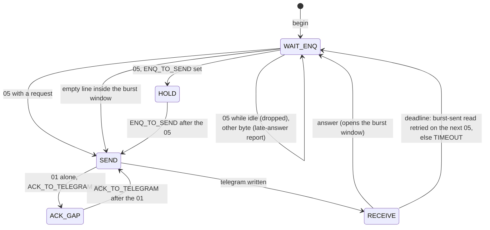
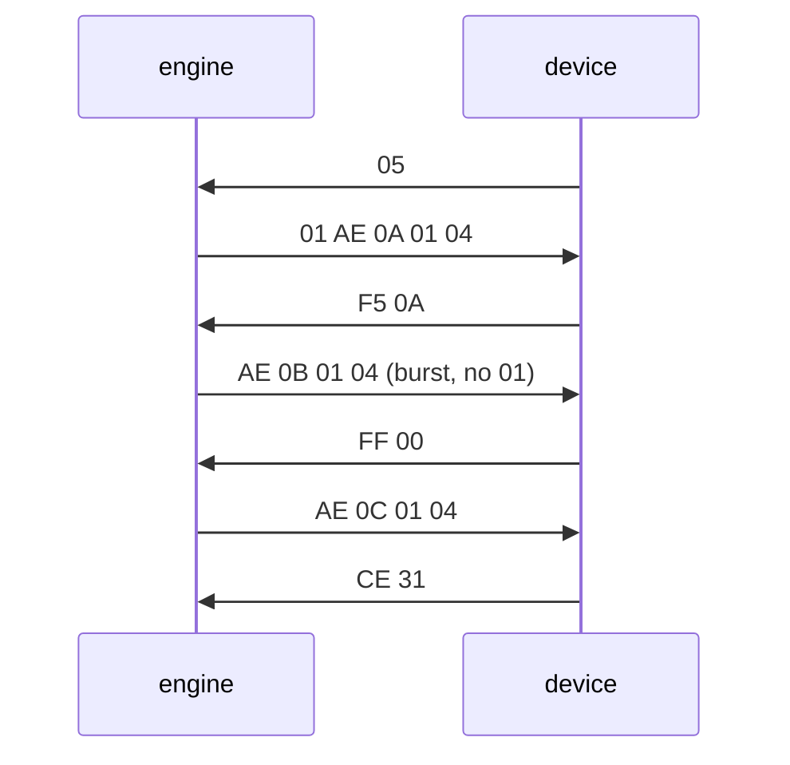

# GWG protocol: field reference

GWG is the Optolink protocol of the Vitodens 200 WB2 class (VR20 controller,
LGM29 burner control, `0x2053` / `0x2054`): ENQ-paced like KW, with eight
access modes, one-byte addresses and no framing at all. The layout of this
file is shared with [kw_protocol.md](kw_protocol.md) and
[p300_protocol.md](p300_protocol.md); the KM-bus behind the controller is in
[kmbus.md](kmbus.md).

Evidence labels:

- **HW**: seen on a unit, with the issue that reported it.
- **Vitosoft**: Viessmann's own export (`ecnEventType.xml`,
  `ecnDataPointType.xml`, `sysDeviceIdent.xml`, `Textresource_de.xml`, the SQL
  link tables).
- **Spec**: openv wiki, vcontrold, vogod, dannerph; not confirmed here.

## Overview

| Issue | Ident | HW | SW | Panel (owner) | Notes |
|---|---|---|---|---|---|
| #13 | `0x2053` | `0x01` | `0x2B` | BES (photo) | first GWG capture, 2026-08-23; EEPROM writes confirmed 2026-11-13 |
| #21 | `0x2053` | `0x01` | `0x7A` | not stated | bursting settled; 13 `be` addresses all `0xFF` |
| #35 | `0x2053` | `0x01` | `0x1E` | BES | Vitodens 200 WB2; VR20 and LGM29 replaced years ago; every `be` address `0x00`-`0xFF` reads `0xFF`; no `kmbus_eeprom` answer |

| Item | Status |
|---|---|
| Reads in `physical`, `virtual`, `eeprom`, `xram`, `port` | HW |
| Bursting | HW (#21, #35) |
| EEPROM writes | HW (#35, the #13 unit) |
| `be` | answers `0xFF` everywhere on two units |
| `kmbus_eeprom`, `kmbus_ram` | never answered |
| Other write types | not confirmed |

Every unit so far reports HW `0x01`, which Vitosoft maps to BEM, and at least
two of them have a BES (see [Identification](#identification)).

## Wire format

| Item | Value | Evidence |
|---|---|---|
| Line | 4800 baud, 8E2 | Spec, HW |
| Idle ENQ | `0x05`, every 749-2070 ms (median 1229) | HW #13 |
| Read on an ENQ | `01 TYPE ADDR LEN 04` | HW |
| Read in a burst | `TYPE ADDR LEN 04`, no `01` | HW #21 |
| EEPROM write | `01 AD ADDR ~V V 04`, one cell per frame, no length byte | HW #35 |
| Other writes | `01 TYPE ADDR LEN <data> 04`, or the EOT before the data (unsettled) | Spec |
| Answer | `LEN` raw bytes; `eeprom` a complement pair, `be` and `port` one byte, per address whatever `LEN` asks; a write one byte | HW |
| Address | one byte | Spec, source |

- **No framing.** An answer has no start byte, type, checksum or address echo,
  and there is no error telegram. An address a mode does not serve answers
  `0xFF` in every byte; a silent datapoint does not answer at all.
- **Timing is the only way to tell an answer from the next ENQ.** `0x05` is a
  legal value.
- **One address byte.** vcontrold's GWG device overrides all 26 of its
  addresses onto one byte; the Vitosoft catalogs' 16-bit addresses do not
  apply. The config refuses an `address`, `state_address` or `target_address`
  above `0xFF` under GWG: the codec refuses to build such a telegram, and a
  telegram that is never built would stall its lane for good.

## Access modes

GWG carries an access mode in the TYPE byte. Each mode is its own address
space: in `GWG_VBES_00`, address `0x01` is five datapoints across four modes
(OEM ident on `kmbus_eeprom`, maximum boiler temperature on `eeprom`, three
outputs on `port`). A wrong mode looks exactly like a wrong address, so every
GWG entity carries `access:`, taken from Vitosoft's `FCRead`. `physical`, the
default, is only 26 % of a GWG device's datapoints (51 of 195 on
`GWG_VBES_00`).

| `access:` | Read | Write | vcontrold | Vitosoft `FCRead` | On hardware |
|---|---|---|---|---|---|
| `physical` | `0xCB` | `0xC8` | `GETADDR` | `Physical_READ` | answers (#21, #35) |
| `virtual` | `0xC7` | `0xC4` | `GETVADDR` | `Virtual_READ` | answers; identification (#13, #21, #35) |
| `eeprom` | `0xAE` | `0xAD` | `GETEADDR` | `EEPROM_READ` | complement pairs (#21, #35) |
| `xram` | `0xC5` | `0xC3` | `GETXADDR` | `XRAM_READ` | answers (#35) |
| `port` | `0x6E` | `0x6D` | `GETPADDR` | `Port_READ` | one byte per address; `0x00`-`0x03` in use (#35) |
| `be` | `0x9E` | `0x9D` | `GETBADDR` | `BE_READ` | one byte per address, `0xFF` everywhere (#21, #35) |
| `kmbus_eeprom` | `0x43` | none | `GETKMADDR` | `KMBUS_EEPROM_READ` | never answers, in seven framings (#35) |
| `kmbus_ram` | `0x33` | none | none | none | never answers (#35) |

The bytes come from four sources that agree: the openv wiki's "Telegramm
Typen", vcontrold's GWG macros (the same frame, `SYNC; GET*ADDR $addr $hexlen
04; RECV $len`), Vitosoft's `FCRead` per datapoint, and vogod's command-type
list (which also leaves both KM-bus modes unwritable). `kmbus_ram` has no
vcontrold macro and no Vitosoft datapoint (none of 4143 across the 22 `GWG_*`
tokens), so only the raw lane sends it. Writes: Vitosoft pairs every writable
datapoint within one mode (`EEPROM_WRITE` 1082, `BE_WRITE` 280,
`PHYSICAL_WRITE` 0), so one mode drives both directions, and the KM-bus modes
have no write byte.

The catalog generator infers GWG from the device token (`GWG_*`, `HV_GWG`),
maps `FCRead` onto `access:` on every entity, and drops addresses above
`0xFF`. It also inverts P300's reachability rule: on P300 only `Virtual_READ`
is readable, which on GWG is 3 % of the data (6 of 195); applied to a GWG
device it kept 8 datapoints and read all 8 on the wrong mode.

### `eeprom`

- One telegram per address. The answer is a pair: byte 0 is the one's
  complement of byte 1, byte 1 is the value (`b0 + b1 == 0xFF`), whatever `LEN`
  asks. 14 of 14 pairs summed to `0xFF`, only `b1` fell inside the declared
  ranges, and burner hours at `0x0017` stepped `E8 17` -> `E7 18` between two
  days (#21).
- `FF FF` means "address not in use", delivered as `0xFF` with
  `Result::unserved_eeprom`; a read-modify-write refuses to merge into it. A
  pair that does not sum to `0xFF` fails the read with CRC.
- One VR20 serves 64 cells: `0x01`-`0x3F` answer, `0x00` and `0x40`-`0x7F`
  answer `FF FF`, `0x80`-`0xFF` repeat the lower half (a dump of all 256
  addresses, #35). Vitosoft's GWG datapoints use `0x01`-`0x24`.

### `be` and `port`

- Both answer one byte per address whatever `LEN` asks (#35, SW `0x1E`), so the
  engine reads them like `eeprom`: one `LEN`-1 telegram per address, sent as a
  burst, delivered together.
- Vitosoft describes `be` as the panel's: `GWG_BetriebsprogrammBEM` (`be`
  `0x57`) is the "Betriebsprogramm der menuegefuehrten Bedieneinheit", the
  menu-driven panel (BEM).
- Both units tried answered `0xFF` at every `be` address, both clock
  locations included (BEM `0xF4..0xF6`, BES `0x74..0x76`). On #35 that fits the
  BES, which has knobs and no menu. The VBES catalogs therefore carry no `be`
  entries.
- Many `be` datapoints have a same-named `physical` copy ("Neigung der
  Heizkennlinie HK A": `physical` `0x65`, `be` `0x20`); plausible values in a
  log usually come from the copy.
- A number or select that reads `0xFF` in every byte shows as unknown when that
  value is outside the number's range or no option of the select; a signed
  field whose range holds -1 keeps it.

### `kmbus_eeprom`

- These reach the LGM29 over the VR20's KM-bus. On #35 all 54 went unanswered,
  with no late bytes either; a 15.7 h audit there sent 1,470 of them and got
  no answer to any. The owner says the KM-bus itself works (the pump answers
  there).
- The generated catalogs leave these datapoints out
  (`GWG_UNANSWERED_FCREAD` in `scripts/vitocatalog/constants.py`);
  `gen_catalog.py --no-reachable-only` brings them back, with their
  `access: kmbus_eeprom`.
- Vitosoft 300 (SID1, `vsmInterfaceCore` 1.4.0.0) has no GWG transport: on a
  GWG unit it reports the device and starts no communication, so its
  `KMBUS_EEPROM_READ` rows are not a frame Vitosoft is known to send.
- Cost while silent: about one ENQ gap plus a 250 ms retry per read, so 54 of
  them overran a 60 s poll cycle until poll backoff set in.
- vitohome sends the generic frame `01 43 ADDR LEN 04`. No source shows a
  working KM-bus read over GWG: vcontrold's `getkmaddr` calls an undefined
  macro (`GETKMDDR`), its test command sends the generic frame; vogod maps the
  byte to no operation; the other Optolink projects only copy Vitosoft's
  function-code list.
- KM-bus telegrams are `DK SK CMD LEN DSL SSK data CRC-lo CRC-hi`
  (CRC-16/KERMIT); `31` reads one byte, `33` N bytes. GWG's two KM-bus TYPE
  bytes are bus commands (`0x33` the read, `0x43` unexplained), and a GWG
  read's `ADDR LEN` is a `33` telegram's data, which suggests the controller
  builds the bus telegram itself. At 1200 baud a bus read and its answer take
  205-260 ms, so a relayed answer cannot come back in the 23-53 ms GWG answers
  take.
- Vitosoft's 90 burner-control `KMBUS_EEPROM_READ` datapoints all carry the
  `PrefixRead` `03 00 00 00 01 01`, which reads as a telegram header (DK `03`,
  SK `00`, CMD `00`, LEN `00`, DSL `01`, SSK `01`) and plausibly names the
  participant. Where Vitosoft puts it in the GWG frame is unknown.
- The candidates, each for address `01`, one byte, sent as open frames
  (`gwg f ...`, `[ ]` appends the CRC):

  | Frame | Idea |
  |---|---|
  | `01 43 01 01 04` | the generic frame (what `access: kmbus_eeprom` sends) |
  | `01 33 01 01 04` | the generic `kmbus_ram` frame |
  | `01 43 03 00 00 00 01 01 01 01 04` | the prefix, then address and length |
  | `01 43 03 00 00 00 01 01 01 04` | the prefix before the address, no length byte |
  | `01 43 [03 00 00 00 01 01 01] 04` | the same with a CRC |
  | `01 43 [03 00 43 0A 01 01 01 01] 04` | a whole telegram, CRC `E2 86` |
  | `01 43 [03 00 33 0A 01 01 01 01] 04` | the same with the bus's read command, CRC `E3 43` |

  `example/vitohome-gwg-kmbus-probe.yaml` sends these and the same seven for
  the ID at `F8`, with a 600 ms deadline. On #35 none of the 14 was answered,
  not even late (2026-11-16).

## Flow

The engine is `GwgExchange` (`optolink_gwg.h`).

The next cell of a per-address read goes out from `WAIT_ENQ` as a burst, on
the window its answer opened.

A per-address read of three `eeprom` cells:

## Timing

| What | Device (measured) | Engine |
|---|---|---|
| Idle ENQ | every 749-2070 ms (median 1229) | - |
| Telegram -> answer | 23-53 ms | answer deadline 250 ms of silence (`LinkWindow::ANSWER_DEADLINE`, 50-2000 ms live) |
| Answer -> a burst-sent telegram | answered under 80 ms (109,520 of 109,521); 80-99 ms 183 and 14 unanswered; 100-139 ms 7 and 29 | burst window 80 ms from an answer or the ENQ a telegram went out on |
| ENQ -> telegram | answered at every delay tried | `ENQ_TO_SEND` 0 (0-100); same pass |
| Our `01` -> the rest | a 30 ms gap made no difference | `ACK_TO_TELEGRAM` 0 (0-100) |
| Bytes after a deadline | - | late-answer report until the next telegram, at most 2500 ms |
| A request | - | watchdog 3000 ms plus what the deadline is raised by |
| Bursting off | - | after 2 burst failures in a row, for the rest of the session |

The answer deadline is a test aid, not a tuning knob: while a request waits,
the device's idle ENQ can land inside it and be read as the payload, so keep it
under the shortest idle-ENQ gap (about 700 ms) for one-byte reads. The
late-answer report already shows a slow answer at the default.

## Quirks

1. **A silent request was completed by the next idle ENQ.** On the first
   capture 9 of 92 reads returned exactly `0x05` after 903-1476 ms, against
   0-90 ms for the 79 real answers; Home Assistant showed a plausible 2.5 °C
   on every `div2` temperature (2026-08-23). Hence the 250 ms deadline, armed
   at the end of the write and re-armed on every byte. It is checked before
   the line is drained: the UART holds an ENQ across a long loop pass, and a
   byte buffered past the deadline is stale. It covers a write's one-byte
   answer too.
2. **VitoWiFi completed a read on the request's frame length** (5), so no read
   of another length ever completed. The engine completes on the datapoint's
   length, and a write on one byte.
3. **Bursting works, without the leading `0x01`.** 25 of 25 burst-sent requests
   were answered without it, 0 of 4 with it (#21). One telegram per ENQ, as the
   openv wiki and vcontrold have it, would take minutes for a catalog. The
   window is stamped only by an ENQ a telegram went out on and by an answer,
   never by an ENQ dropped while idle; any timeout closes it; a pending ENQ
   always wins.
4. **A burst must leave within about 100 ms of the answer** (#35, 40 h,
   2026-11-19/20), hence 80 ms. A late burst costs more than it saves: of 44
   fresh-ENQ retries after one, 35 went unanswered, all of them sent 27-57 ms
   after that ENQ; 9 of 9 sent within 25 ms were answered.
5. **A silent datapoint is not a burst failure.** A burst-sent read that times
   out goes once more on a fresh ENQ with the `0x01`. Answered there, the burst
   failed and counts; unanswered too, the datapoint is silent and the count is
   left alone. Writes are not retried. Without this, two silent `kmbus_eeprom`
   reads in a row turned bursting off for good on #35.
6. **A timeout says little about the link.** Only a request that never went out
   for want of an ENQ (`Result::never_sent`) counts toward "link offline";
   otherwise the silent fault history on #35 published the link offline about
   14 times in 6.5 minutes while the unit kept sending ENQs.
7. **The EEPROM write frame.** The generic layout put the length byte after the
   address, and the unit stored the two bytes after it as the pair (`01:29` or
   `01:04`), which then failed its check. `01 AD 16 CF 30 04` and
   `01 AD 16 D7 28 04` were answered `00` and read back intact, the first again
   16 minutes later; `0x96` followed both (`0x80`-`0xBF` is the same cell).
   Survival across a power cycle, and whether the controller acts on it, are
   not shown. A raw two-byte write (`gwg w AD ADDR B0 B1`) sends the pair
   unchanged, `FF FF` included.
8. **Where the `0x04` goes in other writes is unknown.** This project sends it
   last, dannerph before the payload, the KW sibling none. A write in the
   wrong layout would be answered and store `0x04`, so a value that reads back
   as `0x04` is the sign. The switch is `set_gwg_write_eot_before_payload()`,
   at run time so both can be tried in one session. Reads are the same under
   both.
9. **No PHYSICAL write exists** in Vitosoft, yet `0xC8` was the only write byte
   VitoWiFi could send, which is the likeliest reason no GWG write was
   confirmed anywhere before (openv issue #467; its "writes only return `0x05`"
   fits no answer at all and the next ENQ read as the ack).
10. **An ENQ-to-send delay did not help on #35.** Reads sent 25 ms or more
    after the ENQ went unanswered 4 times in 439, all right after a boot; within
    10 ms 236 in 1,882, in stretches (2026-11-13 to 11-17, not alternating). A
    30 ms gap after the `01` made no difference (85 of 550 against 86 of 550,
    alternating per read, 2026-11-17).
11. **Absent sensors read `0xFF`** (255), for example "Raumtemperatur HK B"
    (`physical` `0x67`) on a single-circuit unit.
12. **Byte order.** The four timers decode little-endian. `xram` `0x88`
    "Wasserdruck" is big-endian although Vitosoft defines it as plain `Int`:
    `01 72` is 1.27 bar against 1.2 bar on the gauge, little-endian 151 bar.
    The catalogs apply it as a hardware finding to every GWG device with the
    row. Bits are numbered MSB-first, as everywhere in Vitosoft
    ([design_notes.md §8e](design_notes.md#8e-vcontrold-numbers-bits-lsb-first-vitosoft-numbers-them-msb-first)).

## Identification

- Four bytes at `virtual` `0xF8`: group, ident, hardware index, software index.
  Vitosoft models it as one 4-byte block (`GWG_SystemIdent_GG/GK/HX/SW`);
  vcontrold reads it the same way (`getDevType`). The hub's identification
  reads it on `virtual` under GWG.
- Vitosoft matches `0x2053` plus `IdentificationExtension`, whose high byte is
  the hardware index:

  | HW | Vitosoft family | Description |
  |---|---|---|
  | `0x01` | `GWG_VBEM_*` | Bedienteil BEM |
  | `0x02` | `GWG_VBES_*` | Bedienteil BES |
  | `0x08` | `GWG_VWMS_*` | BES in the wall-mounting base WMS |
  | `0x10` | `GWG_VBT2_*` | Bedienteil BT2, constant-temperature control |

  `0x2054` is `GWG_BT2`. Naming a bare `0x2053` "GWG_VBEM", as vcontrold does,
  is wrong for three families of four.
- **In practice HW does not name the panel.** #13 and #35 have a BES and report
  `0x01`. Likely the value belongs to the VR20, not the panel; #35's VR20 is a
  replacement.
- Software index: the catalog revisions are `_00`, `_03`, `_21`, `_35`, `_36`
  (decimal: "ab Softwareindex 21" is `0x21`); an index between two revisions
  uses the lower (SW `0x1E` -> `_03`).
- Vitosoft has no other datapoint that identifies the panel.

**BEM and BES catalogs** share every `physical`, `xram`, `port` and most
`eeprom` and `be` datapoints. They differ in the clock (`be`: BEM `0xF4..0xF6`,
BES `0x74..0x76`; VWMS and VBT2 have none) and in the coding cells: the same
setting sits in a different cell per panel ("Heizungsanlagenschema" is BEM
coding (00) at `0x08`, BES coding (04) at `0x04`); BEM only: `0x08`, `0x0A`,
`0x0D`, `0x13`, `0x14`, `0x1C`, `0x21`; BES only: `0x03`. #35's BES unit
answers (46) at `0x0D` (`0x2D`, the same as PHYSICAL `0xA1`), so the VBES
catalogs carry it.

## Engine

| Part | File |
|---|---|
| Codec | `optolink_codec_gwg.h` (`gwg_encode()`, `gwg_encode_mode()`, `gwg_eeprom_pair()`, the access-mode tables) |
| Exchange | `optolink_gwg.h` (`GwgExchange`) |

Constants: deadline 250 ms (50-2000), burst window 80 ms, 2 burst failures,
late watch 2500 ms, watchdog 3000 ms. Variant switches:
`set_gwg_write_eot_before_payload()` (default off),
`set_gwg_burst_omits_enq_ack()` (default on). DEBUG lines: `GWG timing:` (ENQ
age, ENQ->send, `01`->rest, send->answer) for each answered read, and
`GWG 0x.. unanswered:` for each burst-sent read retried.

Proofs: `proof_gwg_exchange.cpp`, `proof_gwg_read.cpp`,
`proof_gwg_access_mode.cpp`, `proof_gwg_burst.cpp`,
`proof_gwg_eeprom_pairs.cpp`, `proof_gwg_enq_misread.cpp`,
`proof_gwg_enq_send_delay.cpp`, `proof_gwg_enq_ack_gap.cpp`,
`proof_gwg_frame.cpp`, `proof_gwg_timeout_kind.cpp`,
`proof_gwg_write_access.cpp`, `proof_gwg_dispatch_stall.cpp`, and the
differential target (161 seeds, boundary seeds at the burst window's 80 and
81 ms).

## Open questions

| Question | Test |
|---|---|
| Does any GWG unit serve `be`? | uwen70's BEM: the same `be` reads as with the BES |
| Does #35's controller keep the BES or the BEM coding map? | Read `eeprom` `0x03`, `0x08`, `0x0A`, `0x0D`, `0x13`, `0x14`, `0x1C`, `0x21` with frames logged; compare codings (02), (03), (04) with the panel |
| How does a GWG unit frame a KM-bus read? | The candidates above, with the KM-bus probe |
| What is the VR20's real baud rate? | A sweep 4400-5200 with a known answer (`virtual` `0xF8`) at each step |
| Where does a write frame's `0x04` go? | A first non-EEPROM write on a unit whose owner accepts the risk |
| Do two coding flags of `0x0005`, toggled back to back, both land? | uwen70's weekend test, restoring both |
| Does the new GWG exchange behave as the old engine on the unit? | uwen70's weekend test firmware |
