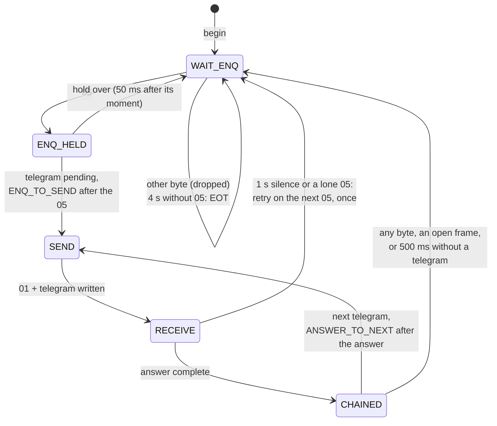
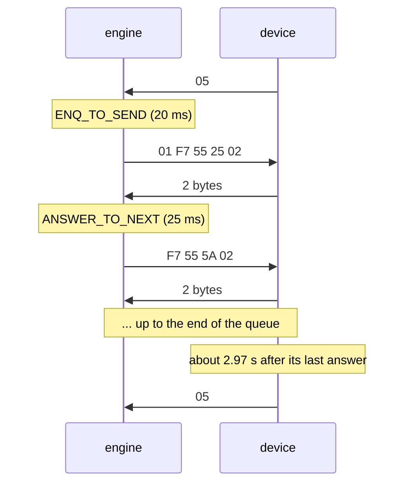

# KW protocol: field reference

KW (VS1) is the older Vitotronic Optolink protocol: no framing, no checksum,
and the device decides who may speak by sending `0x05` (ENQ). A P300
controller falls back to it after an EOT, which is how the P300 engine reaches
the burner control (the KW detour, [p300_protocol.md](p300_protocol.md#kw-detour)).
The layout of this file is shared with [p300_protocol.md](p300_protocol.md)
and [gwg_protocol.md](gwg_protocol.md).

Evidence labels:

- **HW**: seen on a unit. The reference unit is a VScotHO1_72 (`0x20CB`,
  HW `0x03`, SW `0x51`, Vitodens 300-W, ESP32-C3), unless another unit is
  named.
- **Spec**: openv wiki, vcontrold, vogod, dannerph; not confirmed here.

## Overview

| Item | Status |
|---|---|
| Reads, writes, chaining | HW, since 2026-08 |
| Burner-control reads (`6B`) | HW, 2026-10-26 |
| Silence retry | HW, 2026-11-21 onwards |
| Timing points | HW, 2026-11-22 |

## Wire format

| Item | Value | Evidence |
|---|---|---|
| Line | 4800 baud, 8E2 | Spec, HW |
| ENQ | `05`, from the device, about 2.2 s apart on an idle line | HW |
| Request on an ENQ | `01 TT AH AL LEN [payload]` | HW |
| Chained request | `TT AH AL LEN [payload]`, no `01`, no ENQ | HW |
| Read answer | `LEN` raw bytes, no address echo, no checksum | HW |
| Write answer | one byte, `00` for success | HW |
| End of session | `04` (EOT); a P300 controller answers `06` and falls back to KW | HW |

`TT` is the type byte:

| `TT` | Meaning | Evidence |
|---|---|---|
| `F7` | read | HW |
| `F4` | write, `LEN` payload bytes follow | HW |
| `6B` | read of the burner control's address space (GFA) | HW |
| `7B` | PROZESS_READ (Vitosoft: Vitosorp only) | HW: not answered |

## Flow

The engine is `EnqLink` (`optolink_link_enq.h`) in an `Exchange`
(`optolink_exchange.h`).



A typical poll cycle: one ENQ, then the whole chain.



## Timing

| What | Device (measured) | Engine |
|---|---|---|
| The device's ENQ, idle | about 2.2 s apart | - |
| The device's ENQ after its answer | 2968-2984 ms | does not wait for it: chains |
| ENQ -> our `01` | answered up to 200 ms; 255 ms: no answer | `ENQ_TO_SEND` 20 ms (0-100, settable); ENQ hold 50 ms after it |
| Our `01` -> the telegram | answered up to 255 ms | one write each, about 2.1 ms apart |
| `01` + telegram without an ENQ | never answered (61-1409 ms after an answer) | never sent |
| Answer -> next chained telegram | answered up to 911 ms; ignored from 954 ms | `ANSWER_TO_NEXT` 25 ms (0-400, settable); chain window 500 ms |
| Telegram -> answer | 11-39 ms (timed frames), 13-140 ms (reads) | answer deadline 1000 ms of silence |
| Answer -> next `6B` | answered at 25 ms (never tried shorter) | `KW_GFA_GAP_MS` 25 ms |
| No ENQ at all | - | EOT after 4000 ms |
| A request | - | watchdog 4000 ms, from the submit, a retry or an open frame's send |

Measured on the reference unit: timed frames 2026-11-19, the chain-window
probe 2026-11-20 (38 single steps up and down, and eight chained reads before
the gap, with the same edge). Vitosoft itself chains 22-42 ms after an answer.

The settable points are YAML `link_timing:` (`enq_to_send`, `answer_to_next`)
and `id(vito).set_link_timing()`. A value other than the default is logged as
a warning at boot.

## Quirks

1. **Chaining works.** The device answers a long chain off one ENQ: median 29
   telegrams per ENQ, at most 49, and the `01` only on the first (HW,
   2026-08-24, 56 entities). A whole 60 s poll cycle takes 2.1-2.2 s, about
   74 ms per datapoint; one telegram per ENQ would need about 35 s.
2. **The device stops listening about 0.93 s after its answer.** The window
   counts from the last answer, however long the chain. A chain window of
   1500 ms (vogod's) sent a read 1.43 s after an answer into silence; the
   engine uses 500 ms. Past it, a request waits for the next ENQ.
3. **Any byte since the answer ends the chain.** On an idle line that byte is
   the device's next ENQ; a telegram sent across it would leave the `05` to be
   read as the answer's first byte.
4. **Some telegrams on an ENQ meet silence.** 17 of 6066 (0.28 %, 2026-11-21);
   with the `01` and the telegram written in the ENQ's own pass, 0.59 %; with
   the pauses of 20 and 25 ms, 0.40 % (51 of 12,635, 15.3 h). Chained telegrams
   almost never (6 of 153,190). The device's next ENQ follows about 2.97 s
   after the telegram. The engine sends a telegram met by 1 s of silence, or by
   nothing but an ENQ, once more on the next ENQ, with its `01`; 49 of 49
   retries were answered. A partial answer and an open frame are not retried.
   The cause is open (below).
5. **An ignored telegram gets no answer at all.** `01 7B 08 00 02` drew
   nothing; the next ENQ came about 2.25 s later (2026-10-28). Read as data,
   that `05` would be a one-byte answer, so the deadline is checked before the
   line is drained.
6. **The EOT interval sits above the device's own delay.** An EOT sent 3 s
   after the last answer raced the device's ENQ at 2.97 s at the end of every
   chain; at 4 s it does not.
7. **A write is answered with one byte, `00` for success.** VitoWiFi waited
   for the datapoint's length and reported a timeout for every write wider
   than one byte; the clock write to `0x088E` proved it. Any other byte is
   DEVICE_ERROR.
8. **A restart starts afresh.** After a timed frame the hub restarts the
   engine, which waits for the device's next ENQ and counts its EOT interval
   from then, so no stray EOT follows.

## Burner-control reads (`access: gfa`)

A gas boiler has a second controller, the burner control (Gasfeuerungsautomat,
GFA; "FA" in Vitosoft's menus), with its own chip and address space. The
Vitotronic forwards reads into it. Vitosoft reads it with `GFA_READ`: 273
linked events on 53 device tokens in 14 families (VScotHO1/HC1/HC2, VPend*,
VPlus*, VDens*, VSorp, Vitovalor), all KW/P300, none GWG, and no `GFA_WRITE`
anywhere. VScotHO1_72's fan speed, ionisation current, gas-valve drive and
flame-formation time exist only there.

The telegram is a read with type `6B` (HW, 2026-10-26, burner control `0x24`
= NEC):

```
F7 76 50 01 -> 24    GFA_Kennung, the Vitotronic's mirror of the chip   13-81 ms
F7 40 50 01 -> FF    the same address in the Vitotronic's own space     20 ms
6B 40 50 01 -> 24    P80, the chip byte, in the burner control           61-90 ms
F7 40 06 01 -> FF    / 6B 40 06 01 -> 0F    P06, fan speed actual
F7 40 09 01 -> FF    / 6B 40 09 01 -> 10    P09, fan speed setpoint
6B 40 0A 01 -> 1D    P10 fan PWM setpoint   6B 40 54 01 -> 06   P84 burner phase
```

`6B` reaches another space, P80 equals the Vitotronic's copy, and repeated
reads agree. The 56-90 ms answers fit the Vitotronic forwarding each read.

| Range | Content | Example |
|---|---|---|
| `0x0000 + n` | coding parameters Cn | C10 natural gas / LPG |
| `0x4000 + n` | P-parameter n, decimal | P31 `0x401F`, P80 `0x4050`, P140 `0x408C` |
| `0x4100 + n` | P256..P286, 16-bit, Vi chip only | P264 fan drive |
| `0xC0E0..0xC72F` | two 49-entry fault histories of 16-byte records, Vi chip only | `VSKO_FH_HC_01` |

The P-parameters are mostly live values: P00 power, P05 gas-valve drive,
P06/P09 fan speed, P10 fan PWM, P13-P15 ionisation, P17 flame formation time,
P84 burner phase, P85-P88 status, P81/P82 software version, P101-P108 the
coding plug, P70-P79 the coding parameters' limits.

Some parameters depend on the chip, the byte at `0x7650` (and P80), which the
hub logs at boot as `GFA=0x..`. Vitosoft hangs the GFA datapoints under
per-chip menus (`35_FA_VSKO_NEC`, `_GFA`, `_Scot`, `_DOVER...`, `_ViCC...`). A
chip mostly decides which parameters exist (P31-P33 and P140-P148 are
NEC-only); three addresses decode differently: `0x4005`, `0x4009`, `0x401A`
(P09 is x30 rpm under NEC, Scot and the generic menu, x0.3922 % under GFA and
Dover).

Component side:

- `access: gfa` on `sensor`, `binary_sensor` and `text_sensor` only, under KW
  and P300.
- The entity rides the read lane; a write to the same address in the
  Vitotronic's space does not refresh it.
- `queue_raw_gfa_read(address, length)` reads one from a lambda.
- The generator tags each GFA entity `# vito: gfa=<chips>`: the chips whose
  menu lists it (`GFA_MENU_CHIPS`). Rows that decode alike fold into one
  entity with the union of their chips; VScotHO1_72's 104 rows become 77
  entities. The catalog editor filters on the tag.

## Engine

| Part | File |
|---|---|
| Codec | `optolink_codec_kw.h` (`kw_encode()`, `PacketVS1Type`, `KW_GFA_GAP_MS`) |
| Link | `optolink_link_enq.h` (`EnqLink`) |
| Exchange | `optolink_exchange.h`, `optolink_kw.h` (`KwExchange`, `KW_LINK_PARAMS`) |

`KW_LINK_PARAMS`: ENQ hold 50 ms, chain window 500 ms, answer deadline
1000 ms, EOT interval 4000 ms, same pass, one silence retry, `ENQ_TO_SEND`
20 ms, `ANSWER_TO_NEXT` 25 ms. Watchdog 4000 ms.

Proofs: `proof_kw_chain.cpp`, `proof_kw_frame.cpp`, `proof_kw_gfa.cpp`,
`proof_kw_timing.cpp`, `proof_kw_write.cpp`, `proof_sim.cpp` (K), and the
differential target, whose live side runs on VitoWiFi's timing
(`kw_calls::kVs1Timing`).

## Open questions

| Question | Test |
|---|---|
| Why does about 0.4 % of telegrams on an ENQ meet silence? | The recorder with `freeze_on: retry` and `dump_on_freeze: true`, overnight: the µs timing of each silent telegram against the answered ones in the same dumps |
| Does a chained `6B` need its 25 ms? | A timed frame chaining `6B` reads at 0-25 ms |
| Is `0x7650` answered on the 10 devices with a GFA history but no `GFA_Kennung`? | A capture from one of them |
