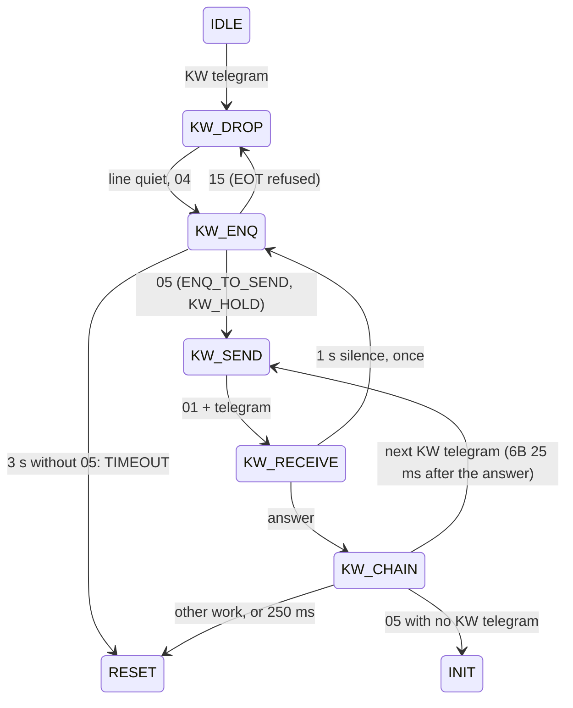
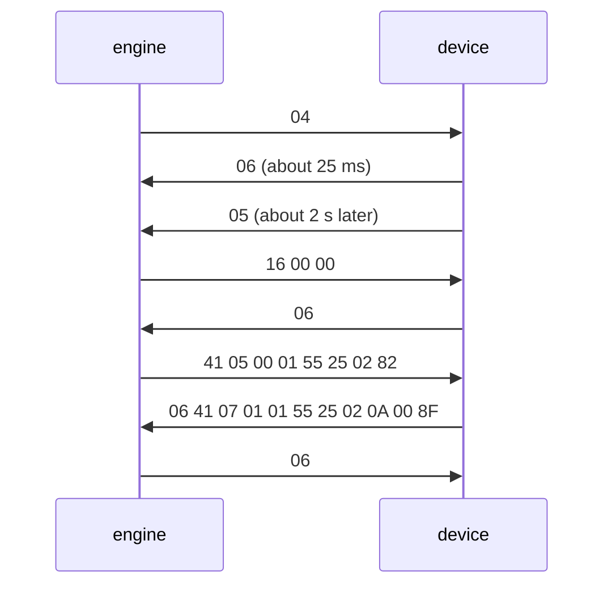

# P300 protocol: field reference

P300 (VS2) is the framed Vitotronic Optolink protocol: a session the master
opens with a SYNC, one telegram at a time with a checksum, an ACK or NACK for
each, and an error frame for a refusal. The device can fall back to KW
([kw_protocol.md](kw_protocol.md)), which the engine uses for the burner
control. The layout of this file is shared with
[kw_protocol.md](kw_protocol.md) and [gwg_protocol.md](gwg_protocol.md).

Evidence labels:

- **HW**: seen on a unit. The reference unit is a VScotHO1_72 (`0x20CB`,
  HW `0x03`, SW `0x51`, Vitodens 300-W, ESP32-C3), unless another unit is
  named. "VDensHO1" is a `0x20C2` unit reported second-hand.
- **Spec**: openv wiki, vcontrold; not confirmed here.

## Overview

| Item | Status |
|---|---|
| Reads, writes, session | HW, since 2026-07 |
| Remote procedure calls (`07`) | HW, 2026-10-21; no action run yet |
| The KW detour (burner control) | HW, 2026-10-27 |
| Timing points | HW, 2026-11-23 |
| The EOT again after the device's 15 | HW, 2026-11-24 |
| The telegram after a NACK waits | HW, 2026-11-25 |
| The first telegram after a SYNC again after a NACK | built, 2026-11-26 |

## Wire format

| Item | Value | Evidence |
|---|---|---|
| Line | 4800 baud, 8E2 | Spec, HW |
| Request | `41 LL 00 FL AH AL DL [payload] CS` | HW |
| Answer | `06`, then `41 LL TT FL AH AL DL [data] CS`; our `06` after it | HW |
| Refusal | `15` (NACK) in place of the `06` | HW |
| Error frame | `TT` = `03`, payload: the code | HW |
| Session start | our `04`, the device's `06`, its `05`, our `16 00 00`, its `06` | HW |
| Keepalive | our `16 00 00` after 3 s without traffic, answered `06` | HW |

- `LL` is 5 plus the payload length; `CS` is the sum of the bytes from `LL`
  to the last payload byte, modulo 256 (the `41` not counted).
- `TT` is the packet type: `00` request, `01` response, `03` error.
- `FL` is a 3-bit message id over a 5-bit function code. The engine sends
  message id 0. A Vitosoft function-code number sent whole lands on whatever
  its low five bits name: on VDensHO1, `0x41` is Virtual_READ with message
  id 2 and returned the virtual data, `0x43` is Physical_READ.
- `DL` is the data length: the answer's for a read, the payload's for a write
  and a procedure call.
- Error codes: `01` the address is not served, `05` the function code is not
  implemented.

| Function code | Name | Status |
|---|---|---|
| `01` | Virtual_READ | HW |
| `02` | Virtual_WRITE | HW |
| `03` | Physical_READ | HW (VDensHO1) |
| `05` | EEPROM_READ; `0x1000..0x11FF` is the coding plug | HW (VDensHO1) |
| `07` | Remote_Procedure_Call | HW |
| `04`, `06` | physical, EEPROM write | raw lane only, `unsafe_raw_writes` |

On VDensHO1, XRAM_READ (`0x31`), Port_READ (`0x33`), BE_READ (`0x35`) and the
KBUS reads (`0x5D`, `0x5F`) drew error `05`. No P300 or KW device in the
export reads through them.

## Flow

The engine is `P300Exchange` (`optolink_p300.h`).

```mermaid
stateDiagram-v2
  [*] --> RESET: begin
  RESET --> RESET_ACK: line quiet, 04
  RESET_ACK --> INIT: 05
  RESET_ACK --> RESET: 15 (EOT refused), or 3 s
  RESET_ACK --> KW_ENQ: 05 with a KW telegram pending
  INIT --> INIT_ACK: 16 00 00 (ENQ_TO_SYNC after the 05)
  INIT_ACK --> IDLE: 06
  INIT_ACK --> RESET: other byte, or 3 s
  IDLE --> INIT: 3 s idle (keepalive)
  IDLE --> SEND: telegram, line quiet
  IDLE --> KW_DROP: KW telegram
  IDLE --> FRAME_SEND: open frame
  SEND --> SEND_ACK: 41 .. CS, one pass
  SEND_ACK --> RECEIVE: 06
  SEND_ACK --> IDLE: 15 (NACK; the first telegram after a SYNC again, once)
  RECEIVE --> RECEIVE_ACK: frame complete
  RECEIVE --> RESET: checksum or frame error
  RECEIVE_ACK --> IDLE: 06 (FRAME_TO_ACK after the frame)
  FRAME_SEND --> RESET: answer collected
```



`SEND` stands for `SEND_START`, `SEND_PACKET` and `SEND_CRC`, all in one pass.
A request whose watchdog (4 s) runs out goes to `RESET` with a TIMEOUT.

The KW detour:



A read, from a closed session:



## Timing

| What | Device (measured) | Engine |
|---|---|---|
| Our `04` -> its `06` | about 25 ms | - |
| Our `04` -> its `05` | about 2 s (1.95-1.98 s) | waits for it; the EOT again after 3 s without |
| Our `04` -> our `16 00 00`, without the `05` | 5-10 ms answered (still in the session); 20-255 ms no answer | never sent |
| Its `05` -> our `16 00 00` | answered up to 100 ms | `ENQ_TO_SYNC` 0 (next pass; 0-100, settable) |
| The `41` -> the rest of a telegram | answered up to 240 ms; 250 ms: NACK (`15 15`) | one pass |
| Before the checksum | answered up to 255 ms | one pass |
| Three pauses of 100 ms in one telegram | answered | - |
| Telegram -> answer | 11-39 ms | - |
| The answer frame -> our `06` | answered up to 400 ms, no repeated answer | `FRAME_TO_ACK` 0 (next pass; 0-400) |
| Our `06` -> the next `41` | 0 ms (one write) to 40 ms answered | `ANSWER_TO_NEXT` 0 (next pass; 0-400) |
| Its NACK -> its last `15` | about 260 ms after the last byte it received | the next write waits for 300 ms of quiet (`P300_QUIET_MS`) |
| Idle session | - | keepalive SYNC after 3000 ms |
| A handshake step | - | 3000 ms, then the EOT again |
| An open frame's answer | - | 500 ms of quiet |
| A request | - | watchdog 4000 ms |
| KW detour: its `05` after our `04` | about 2 s | 3000 ms, then TIMEOUT; `ENQ_TO_SEND` 0 (0-100) |
| KW detour: answer | 13-140 ms | 1000 ms of silence, one retry |
| KW detour: no further KW telegram | - | back to P300 after 250 ms |

Measured on the reference unit: timed frames 2026-11-19, the P300 timing
probe 2026-11-23 (every point answered 12 of 12 across its range, so the
defaults stay 0), the EOT probe 2026-11-24. The settable points are YAML
`link_timing:` (`enq_to_sync`, `frame_to_ack`, `answer_to_next`,
`enq_to_send`) and `id(vito).set_link_timing()`.

## Quirks

1. **After its NACK the device sends one more `15`, about 260 ms after the
   last byte it received; what comes before that `15` is lost** (HW,
   2026-11-24).
   - An EOT 1, 100, 200 and 255 ms after a NACKed timed frame each drew a
     `15` about 258 ms later. Of three EOTs 255 ms apart, the second got the
     `06`. The recorder showed the `15` 274-278 ms after the write stamp of
     the frame's last bytes, about 16 ms of which are on the wire.
   - The engine sends its next write, an EOT or a telegram, only once the line
     has been quiet for 300 ms after a `15` or any unexpected byte. A refused
     EOT goes again after that quiet, not after 3 s; a request queued
     meanwhile would run into its watchdog.
   - The telegram after a NACK waits the same way. Sent at once, it was
     refused too, so NACKs came in pairs (0x0816 1 ms after the NACK of
     0x2500, 2026-11-24); a telegram 47 ms after the last `15` was answered.
2. **The first telegram after a re-SYNC is sometimes NACKed**, an address
   the device serves. 2 in about 14,900 re-SYNCs after a KW detour in 20.7 h
   (2026-11-25, GFA read every 5 s), both `0x5525`, the first sensor after
   the detour, so address and position are not told apart.
   - The `15` came 187 and 155 ms after the checksum; an ACK comes after
     30-40 ms. The telegram after it, 300 ms later, was answered.
   - The engine sends that telegram once more after the quiet. A NACK of any
     other telegram, or of the second try, is the result; the hub logs
     `NACKed after the SYNC, sent again`.
   - The cause is open.
3. **The detour's first telegram meets silence 0.5-0.9 % of the time**
   (20 of 2,228 in 3.7 h, 23 of 2,825 in 4.7 h), chained ones never. The
   engine sends it once more on the next ENQ, as on KW; 45 of 45
   retries were answered in 14.8 h.
4. **A procedure call's DataLength counts the returned bytes** (below). The
   parser takes the payload size from the frame length and the checksum, so
   an answer that repeated the parameter's length would be read too.
5. **There is no read-length cap below 48** (below).
6. **An interior address of a block is refused** with error `01`; read the
   block at its base ([design_notes.md §8g](design_notes.md#8g-never-fabricate-an-address-from-byteposition)).
7. **An answer for an earlier telegram** (same function, other address) means
   the stream is a frame behind: the engine resyncs and reports ERROR. A
   response to another function code (a write acknowledgement arriving for a
   read) is ACKed and reported as ERROR. VitoWiFi delivered both as data.
8. **An error frame is an answer, not data.** VitoWiFi delivered any complete
   frame with a valid checksum, so an error frame's payload was published as a
   value. The engine reports it as DEVICE_ERROR with its code (at most 4
   bytes; VDensHO1 answers an out-of-range EEPROM read with `31 01`). The hub
   counts it as a sign of life, unlike ERROR, which is malformed traffic.
9. **The parser restarts with the session.** VitoWiFi left it mid-frame after a
   timeout, so the next frame was read as the rest of the old one and failed
   once more.
10. **A SYNC must follow the device's `05`.** Sent right after the EOT it is
   ignored after about 10 ms; the device ACKs the EOT about 25 ms after it
   and sends its `05` about 2 s later.
11. **The burner control is not reachable as a P300 function code.**
   `41 05 00 6B 40 50 01 01` and Vitosoft's own `GFA_READ` number sent whole
   (`41 05 00 C9 40 50 01 5F`) are both refused with error `05` (HW,
   2026-10-27; VDensHO1 answers the same). The engine takes the telegram to
   KW instead (the KW detour, below).

## Remote procedure calls (`access: rpc`)

Function code `07`. The request may carry a parameter, and its DataLength is
the parameter's length (0 without one); the controller decides how much it
returns:

```
41 06 00 07 A0 10 01 00 BE                       call 0xA010 with parameter 00
41 0A 01 07 A0 10 05 01 01 01 01 01 CC           the answer: 5 bytes, DataLength 05
```

HW, 2026-10-21, no LON module fitted: the unit answers `07`, and DataLength
counts the returned bytes. Parameter `01` answered `01 00 00 00 00`. KW and GWG
have no RPC telegram.

Vitosoft uses it two ways, under the same `FCRead`:

- **Readings** answer a value. Some take a parameter (`PrefixRead`) naming one
  entry of a list: `Teilnehmerliste_LON_00..15` at `0xA010`, parameters
  `00..0F`, declared as a 6-byte block with the 2-byte field "Anlage/TN" at 0
  (`HexByte2DecimalByte`). The unit answers 5 bytes; the entity reads only the
  2-byte field. Others take none: `KesselfolgeIst` and five siblings at
  `0xA100..0xA109` on a cascade controller, 4 bytes each.
- **Procedures** have an effect: `RPCWink`, `valmRPCClearErrorHistoryTable`,
  `BedienparameterA1M1FunktionReset`. Polling one would run it every cycle.
  The access mode tells them apart (procedures are writable, AccessMode 2/3);
  the one exception, `mBusRPCDeleteReadTableEM2`, is caught by its answer size
  (BlockLength 0).

In the 2026 export 1,010 events read by RPC, 896 with a `PrefixRead`. A reading
is: P300, `Remote_Procedure_Call`, read-only, one record (BlockFactor <= 1), an
answer of known size, and a `PrefixRead` absent or 1..4 bytes.

| Group | Rows | Where | Profile |
|---|---|---|---|
| LON participant list, Vitocom LON identity (`0xA010`), `vlonRPCGetBinding`, `ddcRPCnvi*` | 1,731 | 106 device tokens | `full` only |
| `Kesselfolge*` (`0xA100..0xA109`) | 60 | 10 device tokens | default |
| `mBusRPCCheckHW*`, M-Bus / RS485 scan state | 19 | 3 device tokens | default |
| `ecnsysEventType~VCOMError` (`0xA020`) | 7 | 7 device tokens | default |

The LON-bound readings are answered without a LON module but hold only the
unit's defaults: entry `00`, its own number, `01 01 01 01 01` (Anlage 1 /
participant 1), entry `01` empty. So they are left to `full`.

Component side:

- `access: rpc` on `sensor`, `binary_sensor` and `text_sensor` only;
  `prefix:` is 0..4 bytes. Nothing on the wire tells a procedure from a
  reading, so `access: rpc` belongs on an address the catalog calls a reading.
  Refused under KW and GWG.
- `length:` and `byte_offset:` keep their read meaning but do not go on the
  wire. A write to the same address does not refresh the entity: an RPC answer
  is computed.
- A procedure is a `button` of `type: action` (`VitoActionButton`), queued on
  the write lane, never polled or read back; on its acknowledgement the hub
  re-reads every value. `queue_raw_rpc(address, parameter)` sends one from a
  lambda.

**Actions in the catalogs.** Every procedure the generator can call becomes an
action button in `standard` and `full`, `disabled_by_default` under a warning.
One that resets settings or codings to factory state, or deletes stored data,
is commented out under a DESTRUCTIVE note (`_is_destructive_action`). A call
needs nothing but the parameter (`PrefixWrite`, equal to `PrefixRead` wherever
both are given), so a button keeps the procedures that take no value:

| Shape | Examples | Button |
|---|---|---|
| writable, answers nothing (BlockLength 0) | `valmRPCClearErrorHistoryTable`, `RPCWink`, `KesselfolgeFunktionNext`, a Vitocom's read-out triggers | yes |
| write-only `Array` of one byte, no borders, no unit | `BedienparameterA1M1FunktionReset` (`00`/`01`/`02` per circuit), `Konfi_FunktionReset_GWG`, the heat-pump resets | yes |
| borders, a unit or a numeric type | `RPCLesenFehlertabelle` (0..74), `RPCSetImpulseCounter*` | no: a setter |
| read+write that answers | `RPCSetDigitalOutput*` | no: a setter |

Where a procedure has no `PrefixWrite`, its parameter is Vitosoft's
`FunctionValue` table extension. It matters at `0xA050`, where the parameter
picks the function: `WPR3_Konfi_FunktionNeustart` carries `15` in both,
`Konfi_FunktionReset_GWG` (every coding back to factory state) and
`WPR3_Reset_Parameter_ALZ` only in `FunctionValue` (`0x00`, `0x2E`). A
procedure that names no function in either field is left out where the export
calls the same address with a parameter anywhere (`_rpc_selector_addresses`).
That gives 984 buttons over the 201 catalogs; VScotHO1_72 has six (the three
circuit resets, the coding reset, clearing the fault history and the LON
participant list).

**RPC arrays: the heat-pump fault history.** `ecnsysEventType~WPRError` at
`0xA801` is BlockLength 240 / BlockFactor 30 (V200WO1A, VBC700/702),
`~WPR3Error` 270 / 30 (CU401B). Each record is one call with its index as the
parameter, so the fault-history fan-out
([design_notes.md §7](design_notes.md#7-error-history-layout)) emits one slot
per record at the procedure's address with `prefix: [i]`, as raw hex: the
layout is not decoded and "index 0 is the newest" is not confirmed. Left out:
`WPR3MldgsHistExtTn1..3` (a `PrefixRead` and 30 records, order unknown) and the
`*ErrorIndex` pointers.

## Read length

There is no evidence for a P300 read-length cap. The openv specification names
no maximum, and vcontrold's 9-byte widest read is its own limit. A 42-byte read
works (2026-07-10):

```
>>> 41:05:00:01:73:60:2A:03                (0x2A = 42 bytes)
<<< 06:41:2F:01:01:73:60:2A:<42 bytes>:2B  (length byte 0x2F = 47)
```

22 and 32 bytes worked the same day. The old cap of 37 is most likely a misread
length byte: the answer to a 32-byte read opens `41:25`, `0x25` = 37, because
the length byte counts 5 plus the payload. `MAX_P300_READ_LENGTH` and
`RAW_READ_MAX` are 48: every block the catalogs emit (the widest, 42 bytes, is
proven), so the raw console can test any block read first. Bytes 43..48 are
unverified. Raw writes stay at 32.

## KW detour

A KW telegram (a `6B` read of the burner control, or any `kw` raw operation)
goes over KW:

```
>>> 04                  EOT, leaving P300
<<< 06                  the device ACKs the EOT (dropped)
<<< 05                  its ENQ, 1.95 s later
>>> 01 6B 40 50 01
<<< 24                  P80
>>> 04                  250 ms without another KW telegram
<<< 05                  its ENQ, 1.98 s later
>>> 16 00 00 / <<< 06   P300 again
```

4.4 s on the link for one read, nearly all of it the two ENQ waits (HW,
2026-10-27). Further KW telegrams chain onto the session (`6B` 25 ms after the
answer), so the hub keeps them together: after a read in a space with a switch
cost, the next queued read in that space goes first. A KW telegram queued
while the link returns to P300 goes out on the ENQ that return waits for. An
ENQ while the KW session idles is answered with SYNC at once.

This is Vitosoft's own route: its interface switches to KW (`VSKOStart`)
before the burner-control reads and back afterwards (`VSKOStop`), according
to an independent reading of its assemblies (not checked here); all 269
`VSKO_*` event types read with `GFA_READ`. Two shortcuts are reported not to
work on VDensHO1: a SYNC right after the EOT, before the ENQ, and entering P300
on an idle ENQ without an EOT (about 1 s slower).

On VDensHO1 a GFA read answers `FF` in place of the value about 0.5 % of the
time (reads about 50 ms apart; 0.18 % at 150 ms). Not seen here; the hub
publishes the answer as it comes.

## Engine

| Part | File |
|---|---|
| Codec | `optolink_codec_p300.h` (`p300_encode()`, `P300Parser`, `P300Frame`) |
| Exchange | `optolink_p300.h` (`P300Exchange<Port, SilenceRetries, QuietMs>`) |

Constants (`optolink_p300.h`): watchdog 4000 ms, handshake retry 3000 ms,
keepalive 3000 ms, quiet after the device's bytes 300 ms, open-frame quiet
500 ms; detour: ENQ wait 3000 ms, answer deadline 1000 ms, linger 250 ms, one
silence retry. The differential target runs `P300Exchange<Port, 0, 0>`, the
pacing VitoWiFi's `VS2Engine` had.

Proofs: `proof_p300_eot_refused.cpp`, `proof_p300_frame.cpp`,
`proof_p300_gfa.cpp`, `proof_p300_guards.cpp`, `proof_p300_kw_retry.cpp`,
`proof_p300_rpc.cpp`, `proof_p300_timing.cpp`, `test_p300_transaction.cpp`
(golden captures, fragment reassembly), `proof_vs2_zero_payload.cpp` and
`fuzz_parser_vs2.cpp` (the parser).

## Open questions

| Question | Test |
|---|---|
| Why is the first telegram after a re-SYNC sometimes NACKed, and is its second try always answered? | The recorder, `freeze_on: retry`, on a long audit with the GFA read every 5 s |
| What is the layout of a heat-pump fault record, and is index 0 the newest? | One captured record with the controller's own reading (CU401B_S) |
| Are `Kesselfolge*` and `mBusRPCCheckHW*` free of side effects? | A read on a cascade controller and an M-Bus module |
| Does an action button do what it says? | One harmless procedure, pressed on purpose |
| How should "Anlage/TN" (`HexByte2DecimalByte`) decode? | Two decimal bytes; today one 16-bit number (`01 01` reads 257) |
| Do bytes 43..48 of a read come back? | A 48-byte block read |
